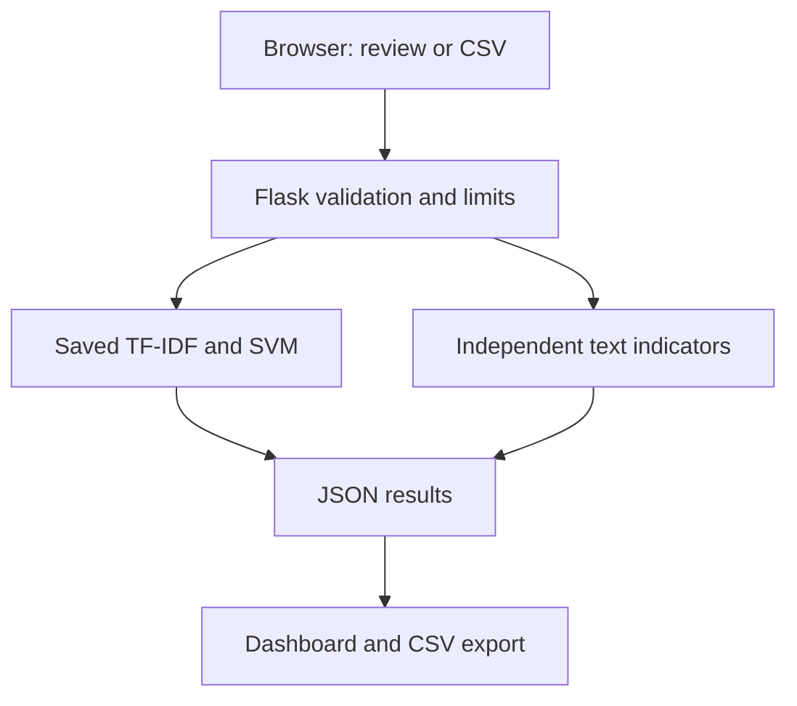

# ReviewLens — Fake Product Review Detection

B.Tech Applied Data Science mini project for Challa Rakesh.

A working Flask + scikit-learn application with a responsive HTML/CSS/JavaScript frontend. It supports single English reviews, CSV batches, product summaries, word contributions, independent linguistic indicators, and safe CSV exports. A trained model is included; predictions are never random or hardcoded.

**Scientific scope:** this is an original-review versus GPT-2-generated-review classifier. The UI labels “Likely Genuine” and “Potentially Fake” are shorthand for those dataset classes, not verified truthfulness. Never use this app alone to accuse a reviewer.

## Delivery status

- Application, trained model, evaluation, API tests, and documentation: included.
- GitHub upload and Render deployment: in progress using the existing `rakeshchalla19/fake-review-detector` repository and connected Free web service.
- API/inference tests executed locally; see `reports/verification.md`.
- Visual browser QA and deployed end-to-end verification remain pending.

## Quick start (no training required)

Install Python 3.12. The included joblib pipeline was produced with scikit-learn 1.8.0; use the pinned dependencies. Only load trusted joblib files.

```bash
python -m venv .venv
```

Activate the environment:

```powershell
# Windows PowerShell
.venv\Scripts\Activate.ps1
```

```bash
# macOS / Linux
source .venv/bin/activate
```

Then:

```bash
python -m pip install -r requirements.txt
python app.py
```

Open http://127.0.0.1:5000. Stop with Ctrl+C. The built-in server is for local demos; Render uses Gunicorn. No API keys, paid AI services, or database are required. `.env.example` documents optional variables; the app does not automatically load `.env` files.

## How to use

1. Open **Analyze**, enter an optional product name and an English review (30–5,000 characters, at least 6 words), then analyze.
2. Or open **Bulk review**, download the sample, and upload a UTF-8 CSV with `review` and optional `product` columns. Limit: 200 rows / 1 MB including multipart overhead.
3. The dashboard shows labels, signed margins, flagged share, and product summaries. Expand each card to inspect model contributions and independent indicators.
4. Download results as CSV. Spreadsheet-formula-like cells are prefixed with an apostrophe for safer opening; exported strings can therefore differ slightly from input.
5. Clear results or refresh to erase the in-tab analysis. The newest batch replaces the previous batch; batches are not accumulated.

Example files contain authored demonstration text, not labeled test samples. Promotional wording does not guarantee a fake classification.

## Technology and architecture

- **Flask:** a small, beginner-friendly Python server that serves HTML and JSON from the same origin; avoids a separate frontend build and CORS configuration.
- **scikit-learn:** serialized TF-IDF + Linear SVM pipeline, loaded once at startup.
- **pandas:** CSV dataset preparation and experiment reporting.
- **Vanilla HTML5/CSS3/JavaScript:** responsive UI without a JS framework or CDN dependencies.
- **langdetect:** deterministic, approximate language screening; can reject valid short/mixed English.
- **Gunicorn:** one worker / two threads on Render. The in-memory global request cap depends on this single-worker configuration.



The model uses review text only. Product name is grouping metadata and never changes predictions. Similarity compares only reviews in the current batch, using a separate unigram/bigram TF-IDF vectorizer.

## Project layout

```text
app.py                    Flask routes, validation, inference, safeguards
train.py                  Dataset cleaning, splitting, model comparison
scripts/download_data.py  Original OSF download with SHA-256 verification
scripts/verify_live.py     HTTP smoke tests for a deployed service
static/                   CSS and client JavaScript
templates/index.html      Responsive page shell and all application screens
models/model.joblib       Included fitted preprocessing + classifier
reports/metrics.json      Full actual results, versions, category breakdown
reports/split_manifest.csv Hashed normalized review IDs and split assignments
reports/EVALUATION.md      Human-readable evaluation
reports/training.log       Captured training output
data/                     Source/license metadata, data dictionary, sample CSV
docs/PROJECT_GUIDE.md      Mini-project explanation, demo, viva answers
tests/test_app.py          Inference, validation, API and safety tests
render.yaml               Render Blueprint configuration
requirements*.txt         Pinned runtime/test dependencies
```

## Dataset, attribution and license

Original dataset: https://osf.io/tyue9/

Salminen, J., Kandpal, C., Kamel, A. M., Jung, S.-G., & Jansen, B. J. (2022). *Creating and detecting fake reviews of online products*. Journal of Retailing and Consumer Services, 64, 102771. https://doi.org/10.1016/j.jretconser.2021.102771

The original OSF node links to **CC BY 4.0** (not inferred from the paper's license). The license relationship and full license response are captured in `data/source.json` and `data/license.json`; file version and checksum are in `data/files.json`. License: https://creativecommons.org/licenses/by/4.0/ . No endorsement by the authors is implied.

- `OR`: original product reviews, presumed human/authentic, not independently verified as honest.
- `CG`: GPT-2-generated reviews. Not a human-deception annotation or platform-filter decision.
- Source rows: 40,432 across ten product categories.
- Changes: normalized duplicate detection, conflicting-label removal, near-duplicate collapsing, TF-IDF transformation and supervised training. Raw source text is not rewritten for modeling.
- Raw data is downloaded separately rather than redistributed in the project archive.

See `data/DATASET.md` for the data dictionary and provenance.

## Reproduce training

```bash
python scripts/download_data.py
python train.py
```

The downloader verifies SHA-256 `ea03422988824bc917b5f7217e3867e27b597c647d5261adfae73cd7a85e1e1a`. A changed release is rejected; do not silently replace the checksum. Downloading requires internet access to OSF. If necessary, download the original CSV manually as `data/reviews.csv` and run the downloader to verify it.

Training steps:

1. Normalize case, punctuation and whitespace for duplicate detection. Remove empty normalized text and conflicting exact labels; retain one exact copy.
2. Find approximate near-duplicate candidates with MinHash LSH (128 permutations, seed 42, candidate threshold 0.70). Confirm candidates using 3-word-shingle Jaccard ≥ 0.85. Collapse connected components; drop conflicting-label components. Candidate search can miss duplicates; this is not a proof that all duplicates are gone.
3. Split retained reviews 60/20/20, stratified by label, seed 42. Product/user identifiers are unavailable; product-disjoint or reviewer-disjoint evaluation cannot be established.
4. Fit word unigram/bigram TF-IDF only on training data: `min_df=2`, `max_df=.98`, `max_features=60000`, sublinear term frequency.
5. Compare a majority-class baseline, Logistic Regression (`C=1`) and Linear SVM (`C=1`). Select using validation CG F1, not test results. No hyperparameter search was performed.
6. Report held-out test results for all models. Save the selected training-only fitted pipeline; do not refit on the test set. Restart the app after retraining.

See `reports/EVALUATION.md` for actual metrics. Scores are uncalibrated decision margins; no confidence/probability percentage is claimed. Top terms are exact `TF-IDF value × linear coefficient` contributions, with an intercept. Only the six largest absolute contributions are displayed.

## API

| Endpoint | Method | Input / response |
|---|---|---|
| `/health` | GET | 200 if model loaded; otherwise 503 |
| `/api/model` | GET | Actual experiment metrics and methodology |
| `/api/analyze` | POST | JSON: `{"review":"...","product":"optional"}` |
| `/api/bulk` | POST | Multipart form with a `file` CSV |
| `/sample.csv` | GET | Downloadable valid sample |

Prediction endpoints return `results`, `summary`, `score_meaning`, and `limitation`. Errors return JSON `error`. Statuses include 400 invalid input, 413 oversized upload, 429 throttled, and 503 unavailable. A malformed row rejects the batch with a row number; nothing is partially stored.

## Tests

```bash
python -m pip install -r requirements-dev.txt
python -m pytest -q
```

Tests use the included real model and check API/model score consistency, contribution reconstruction, language and length checks, malformed CSV, row limits, file sizes, grouping, similarity, missing-model behavior, request limits, and security headers. No mock scores are substituted.

## GitHub upload

Intended account: https://github.com/rakeshchalla19
Repository: https://github.com/rakeshchalla19/fake-review-detector . This existing repository and connected Render service are used for this project.

Create an empty repository in that account (do not add a remote README), then run in this folder:

```bash
git init -b main
git add .
git commit -m "Build ReviewLens with trained SVM and evaluated pipeline"
git remote add origin https://github.com/rakeshchalla19/fake-review-detector.git
git push -u origin main
```

Authenticate through GitHub's normal sign-in or credential manager. Never put tokens in project files. The model is about 1.1 MB and is deliberately tracked. The original downloaded CSV, virtual environment, secrets, and caches are ignored.

## Render deployment

1. Sign in at https://dashboard.render.com and connect the GitHub repository.
2. Choose **New → Blueprint**, select the repository, and use the included `render.yaml`. Review the selected **Free** plan before creating resources.
3. Alternatively create a Python Web Service, build `pip install -r requirements.txt`, start `gunicorn app:app --bind 0.0.0.0:$PORT --workers 1 --threads 2 --timeout 120 --access-logfile /dev/null`, and health path `/health`.
4. Set Python 3.12.8, `REQUESTS_PER_MINUTE=30`, `OPENBLAS_NUM_THREADS=1`. The serialized model must be committed. Training is intentionally not run during deployment.
5. Wait for the dashboard to report Live, then use the actual assigned HTTPS URL. Do not assume the requested service name determines the URL.
6. Verify the deployed API:

```bash
python scripts/verify_live.py https://YOUR-ACTUAL-SERVICE.onrender.com
```

7. In a browser also test a single example, sample CSV upload, product summary, details expansion, exported CSV, invalid input, and mobile navigation. Compare `/api/model` with the included report. Record the URL and verification time before claiming deployment success.

**Hosting limitations:** Render's Free web services sleep after 15 minutes without traffic and take about one minute to wake. Free instance hours are shared across a workspace (750/month under the checked documentation); limits or account verification can affect availability. This plan does not promise uninterrupted public service. Paid always-on service has a cost: review current pricing before choosing it. No paid plan has been provisioned by this project. Sources: https://render.com/docs/free and https://render.com/pricing . Hosting terms may change.

## Privacy, safety and operational limits

No database, browser localStorage, analytics, or submitted-text logging is used. Uploads are at most 1 MB and handled in memory. Prediction content is returned to the submitting browser only. Infrastructure can retain HTTP metadata. CSP blocks third-party scripts and inline script execution; user content uses `textContent`, not HTML insertion. Exports neutralize spreadsheet formula prefixes.

There is a global 30 POST requests/minute cap per running process. This bounds compute without trusting forwarded client IP headers, but one user can consume the shared quota. For a multi-worker or larger public deployment, add a shared rate limiter and edge protection; adjust the documented worker assumptions. Hosting-level DDoS protection is not implemented here. No URL scraping is offered; authorized review retrieval would require an appropriate platform API and permissions.

## Limitations and future work

Historical GPT-2 text is different from current AI writing, and original reviews may themselves be deceptive. Class balance, review length, category and generation artifacts can inflate benchmark scores. English-only screening is imperfect. Near-duplicate search is approximate. Unseen-category and real-world false-accusation rates are not established. Heuristics do not change the model output. Next steps: obtain licensed verified-deception data, product-disjoint evaluation, modern-generator test sets, probability calibration on a separate set, uncertainty/abstention, multilingual evaluation and external review.

See `docs/PROJECT_GUIDE.md` for the presentation and viva guide.
